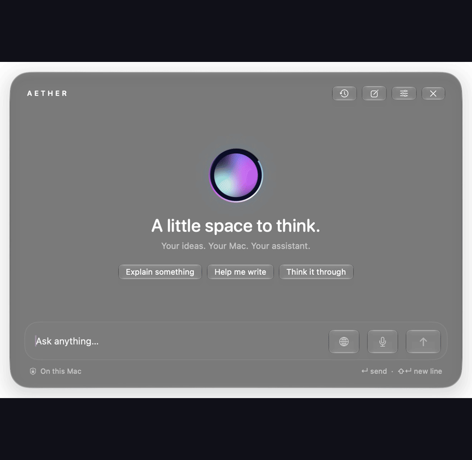

<div align="center">

<h1>Aether</h1>

<p><strong>Local AI. Right where you work.</strong></p>

<p>A native macOS assistant for coding, writing, and research.<br>Bring it forward with a shortcut. Keep inference on your Mac. Connect to the web when you choose.</p>

<p><sub>macOS 26+ · SwiftUI + Liquid Glass · Ollama · Developer preview</sub></p>

<p><a href="#get-started">Get started</a> · <a href="#see-aether-in-action">See the demo</a> · <a href="#your-mac-your-model-your-choice">Privacy</a> · <a href="docs/TECHNICAL_GUIDE.md">Technical guide</a></p>

</div>

## See Aether in action



**A real workflow, captured from the running app.** Draft a C word counter, refine whitespace handling, then switch on Web for a sourced answer. The walkthrough is edited for pacing; the interface and model responses are genuine.

[Watch the MP4](docs/media/aether-demo.mp4) · [View the coding screenshot](docs/media/aether-code.png) · [View the research screenshot](docs/media/aether-web.png)

## Keep your flow

**One shortcut away.** Press **⌥ Space** to bring a compact assistant above your workspace. Ask a question, get a streamed answer, and press **Esc** to get back to work. Aether stays in the menu bar and out of the Dock.

**Built for the Mac.** Native SwiftUI, actual Liquid Glass controls, a floating AppKit panel, and an animated AI orb. Aether follows your appearance and accessibility preferences.

**Useful for real development work.** Write and explain code, follow up on an edge case, and copy individual code blocks. Syntax highlighting supports C/C++, Swift, Python, JavaScript/TypeScript, Rust, Go, and other common languages.

**Research when you need it.** Enable the globe to search the web or read a public HTTPS URL. Answers include clickable sources, labeled to show whether Aether read the page or only retrieved a search excerpt.

**Conversations that stay with you.** Reopen, search, rename, and delete local chats. Stop an answer, regenerate it, or return to an earlier conversation without starting over.

## Your Mac. Your model. Your choice.

Aether connects to **Ollama running on your Mac**. It does not require an Aether account or a cloud-model API key. Choose an installed local model and tune its context budget, response limit, temperature, and system prompt.

| Mode | What leaves your Mac | Where the answer is generated |
| --- | --- | --- |
| **Web off** | No prompts or chat history are sent to an external service. | Your local Ollama model. |
| **Web on: search** | The current question is sent to Bing search, and public pages may be fetched. Earlier chat messages and your system prompt are not sent to the search engine. | Your local Ollama model, using retrieved excerpts. |
| **Web on: direct URL** | The requested URLs are fetched from their websites. | Your local Ollama model, using the page text. |

Web is **off by default**. Aether has no telemetry or CloudKit chat sync. History is stored locally with SwiftData; it is not separately encrypted by the app. Internet is needed for initial downloads, updates, and optional web access—not for offline chat after setup.

## Get started

This repository currently provides a **source build**. A signed, notarized installer is not published here yet.

### 1. Prepare your Mac

- **macOS 26 or later** and Xcode with a macOS 26+ SDK.
- **Apple silicon recommended.** The reference setup is a base M4 MacBook Pro with 16 GB unified memory.
- **[Ollama](https://ollama.com/download/mac)** installed and running.
- Around **6.6 GB of disk space for the default model**, plus runtime memory, Xcode, and build storage.

### 2. Install a local model

```sh
ollama pull huihui_ai/qwen3.5-abliterated:9b-q4_K
```

The current default is the community **Huihui Qwen 3.5 9B abliterated** variant in **Q4_K_M**. You can choose another installed local model in Settings. Aether does not download models automatically.

### 3. Build and launch

```sh
git clone https://github.com/P4ST4S/aether_app.git
cd aether_app
./Scripts/build.sh
./Scripts/run.sh
```

The build script installs **`/Applications/Aether.app`**. Launch it once, then use **⌥ Space** or **Show Aether** in the menu bar. Configure your preferred shortcut in **Settings → General**.

Quit Aether before installing an update. The included Xcode project is ready to open; XcodeGen is only needed when changing project configuration. The first build downloads the pinned HTML-parser dependency.

[Full setup, troubleshooting, and model configuration →](docs/TECHNICAL_GUIDE.md)

## Make it yours

| Control | What you can change |
| --- | --- |
| **Local AI** | Installed model, local endpoint, context length, temperature, response limit, system prompt, and Qwen thinking. |
| **General** | Global shortcut, appearance, and orb animations. |
| **Web** | Enable or disable search and public-page reading. |
| **History** | Review and manage conversations stored on this Mac. |

The default **8,192-token context** is a starting point for a 16 GB Mac. Larger contexts use more memory. Qwen thinking is disabled by default to reduce the wait before an answer begins.

<details>
<summary><strong>Keyboard shortcuts</strong></summary>

| Shortcut | Action |
| --- | --- |
| **⌥ Space** | Show or dismiss Aether; configurable. |
| **Return** | Send a message. |
| **⇧ Return** | Insert a new line. |
| **⌘ .** | Stop generation. |
| **Esc** | Dismiss the panel while Aether keeps running. |
| **⌘ N** | Start a new conversation. |
| **⇧ ⌘ H** | Open conversation history. |
| **⌘ ,** | Open Settings from the panel. |

</details>

## Current scope

Aether is a **developer preview** focused on local chat and optional web research. It does not control your computer, inspect your screen, browse your private files, or attach documents to a conversation.

Web retrieval reads static text pages. Sites that require JavaScript, sign-in, or PDF downloads are not supported. Search availability and relevance depend on Bing's public RSS interface. Model responses can be inaccurate; source links help you check them.

Native dictation and read-aloud are implemented but still need broader testing across permissions, languages, and audio hardware. No performance number in this README is a promise about your Mac or chosen model.

## For developers

Swift 6 with strict concurrency, `@Observable` state, SwiftData persistence, native URLSession streaming, and a small inference interface that keeps the UI independent of Ollama. SwiftSoup is used for local HTML parsing; its version is pinned.

```sh
./Scripts/test.sh
```

The standard suite runs without web requests or model downloads. **37 tests passed in the latest recorded run with the live web check enabled.** Build results, test scope, live-demo observations, and remaining verification are documented in [VALIDATION.md](VALIDATION.md).

[Architecture and detailed setup](docs/TECHNICAL_GUIDE.md) · [Third-party notices](THIRD_PARTY_NOTICES.md) · [Report an issue](https://github.com/P4ST4S/aether_app/issues)

---

**Aether is an independent macOS application.** It is not affiliated with Apple or Ollama. Product names belong to their respective owners.
